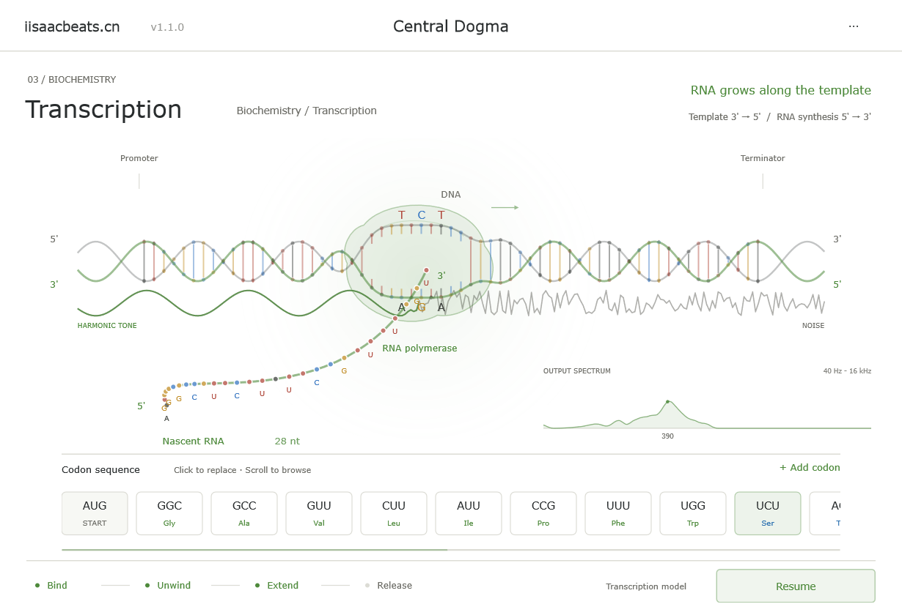
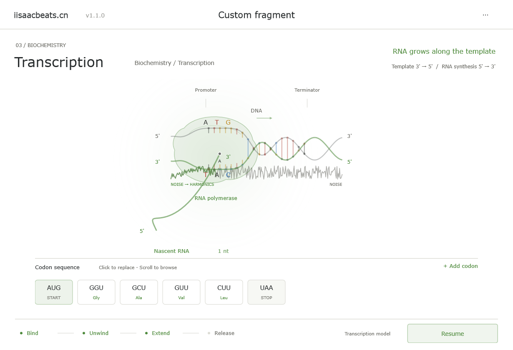

<h1 align="center">Transcription</h1>

<p align="center"><strong>基因即音序 · 转录把噪声雕成音色</strong></p>

<p align="center">
  <em>Read a gene — the polymerase carves noise into a timbre.</em>
</p>

<p align="center">
  
  
  
  
</p>

<p align="center">
  <code>A · T · C · G → 布朗噪声 → 8 路谐振 → 三套空间</code><br>
  <code>核心密码子 → 谐波结构 ｜ 中间区 → 湿音浓度 ｜ 终止密码子 → 效果链拓扑</code>
</p>

---

## 概述 / Overview

**Transcription** 是一款把中心法则做成演奏界面的噪声减法合成器。你拖动 RNA 聚合酶沿 DNA 移动（或点自动播放），转录进度实时决定布朗噪声被雕成乐音的程度——**转录到哪，音色就塑形到哪**。

> **中文**：一款以转录动画为唯一场景的 8 声部噪声减法合成器。没有传统振荡器：布朗噪声是唯一的激励源，聚合酶读过的密码子把噪声筛成谐波、决定空间，未读过的部分仍是混沌噪声。术语与数值都来自分子生物学——密码子、氨基酸疏水性、终止密码子——但映射是乐器设计，不是对生物声学的测量。
>
> **English**: An 8-voice noise-subtractive synthesiser whose only scene is transcription. There is no oscillator: brown noise is the sole excitation, and the codons the polymerase has already read carve it into harmonics and space, while the unread part of the gene stays chaotic noise. The vocabulary comes from molecular biology; the mapping is instrument design, not a claim about bioacoustics.

> 分类 Category：Synth / Instrument ｜ 插件代码 Plug-in Code：`CE03` ｜ 厂商 Vendor：iisaacbeats.cn

---

## 预览 / Preview

<p align="center">
  
  
</p>

<p align="center">
  <code>左：Central Dogma 转录中 · 实时输出频谱 ░ 右：第四个密码子之后，噪声开始变正弦</code><br>
  <em>left: mid-transcription with the live output spectrum — right: just past the fourth codon, noise turns into a sine.</em>
</p>

---

## 功能模块 / Modules

| 模块 / Module | 功能描述 / Description |
|------|---------|
| **转录场景 Transcription scene** | 单场景：DNA 双螺旋、启动子 / 终止子、聚合酶沿链移动、RNA 边合成边生长，Bind → Unwind → Extend → Release 四阶段。拖动聚合酶或自动播放，转录进度直接驱动音色。<br>*A single scene: double helix, promoter/terminator, polymerase travelling along the strand, RNA growing behind it, four stages. Drag or auto-play; progress drives the timbre.* |
| **密码子编辑 Codon editing** | 20 个常见密码子紧凑选择器 + 64 个全密码子；点击替换、横向拖动滑动、右键删除、`+ Add codon` 插入；64 步撤销 / 重做。<br>*20-codon compact picker plus all 64; click to replace, drag to scrub, right-click to delete, insert at will; 64-step undo/redo.* |
| **减法核心 Subtractive core** | 布朗噪声经 8 路并联带通（f0 × k）成声；带通数 1–8 由核心密码子的平均 slope 决定，谐波衰减指数同源；再经频谱倾斜低通、共振峰、奇偶偏置与预热饱和。实测 39.5% 的随机三密码子组合落在 1 路。<br>*Brown noise through 8 parallel band-passes at f0 × k; 1–8 bands follow the core codons' mean slope; then tilt low-pass, formant peak, odd/even bias and soft drive.* |
| **身体效果 Body FX** | 中间区密码子生成 6 个性状基因（增长 / 空间 / 运动 / 呼吸 / 色调 / 微光）+ 序列种子；全局立体声链位于声部求和与 AGC 之后，按终止密码子切换三套拓扑：UAG 孢子（Pluck）、UAA 星云（Pad）、UGA 声腔（Lead），切换 80 ms 交叉淡化。湿音从第 4 个密码子起随转录逐渐变浓，到终止密码子达到满量。<br>*Body codons become six trait genes plus a sequence seed; a global stereo chain after the voice sum, with three topologies chosen by the stop codon (UAG Spore, UAA Nebula, UGA Voice) and 80 ms cross-fades. Wet depth ramps from the fourth codon to the terminator.* |
| **实时频谱 Output spectrum** | 真实输出的 4096 点 FFT，96 个对数频段（40 Hz–16 kHz），Catmull-Rom 平滑、峰顶保持、局部峰标注；纯噪声时是 −6 dB/oct 斜线，核心介入后长出等间距谐波峰。<br>*A real 4096-point FFT of the output, 96 log bands, smoothed with peak hold and labelled partials; a −6 dB/oct slope for noise, evenly spaced peaks once the core engages.* |
| **预设与状态 Presets** | 5 个工厂序列：Central Dogma、Insulin、Hemoglobin、Fluorescence、Start + Stop。默认加载 **Insulin / INS**（DNA、核心区与 body 区完整，第一次播放即可听到从噪声到完整音色的全过程）；序列与转录进度随宿主工程保存。<br>*Five factory genes; the default is **Insulin / INS** (a complete DNA / core / body layout, so the first play already runs the full noise-to-tone arc); sequence and progress persist with the host project.* |
| **转录进度与自动化 Progress & automation** | 宿主可见参数只有一个 **`Transcription progress`**（0–100 %，内部 `scan`）：0 % 纯布朗噪声、100 % 完整音色。可被 DAW 自动化、随工程保存，重开工程恢复聚合酶位置；界面动画与参数双向同步（播放 / 拖动时按 60 ms 节流写回）。<br>*A single host parameter — **`Transcription progress`** (0–100 %, internal `scan`): 0 % is pure brown noise, 100 % the full timbre. Host-automatable and saved with the project; the UI animation and the parameter stay in two-way sync.* |
| **首次引导 First-run guide** | 首次打开且仍是默认 Insulin 时，右下角显示引导卡（`Press Start transcription` / `C5 is held for you`），并自动按住 C5（MIDI 72）试听音色变化；用户打断立即释放，正常完成后再保持 1.5 s。可经 `··· → Show intro again` 再次查看。<br>*On first open with the default Insulin, a hint card appears and C5 (MIDI 72) is auto-held so you can hear the timbre change; releasing on interruption, held 1.5 s after completion. Re-open via `··· → Show intro again`.* |

---

## 技术栈 / Tech Stack

| 项目 / Item | 版本 / Version |
|------|------|
| 语言 Language | C++17 |
| 框架 Framework | [JUCE](https://juce.com) 8.0.12（FetchContent 自动拉取） |
| 构建 Build | CMake ≥ 3.22 |
| 格式 Formats | VST3（macOS 另加 AU）。Standalone 仅为本地测试构建，**不随用户安装包分发** |
| DSP | 自研噪声减法核心 + 三套身体效果链，FFT 使用 `juce_dsp` |

---

## 构建 / Build

```bash
git clone https://github.com/sweetorange1/Transcription.git
cd Transcription
```

### Windows

```powershell
# 一键构建 VST3 + Standalone（Standalone 仅用于本地测试），并运行全部离线回归
.\build.ps1
```

产物位于 `cmake-build-ninja/Transcription_artefacts/Release/`（`VST3/ChemE-Transcription.vst3`、`Standalone/ChemE-Transcription.exe`）。分发给用户的是 `VST3`；`Standalone` 仅供本地测试。

### macOS

```bash
cmake -B cmake-build-release -DCMAKE_BUILD_TYPE=Release
cmake --build cmake-build-release --config Release
```

产物位于 `cmake-build-release/Transcription_artefacts/Release/`（`VST3`、`AU`，以及仅供本地测试的 `Standalone`）。分发给用户的是 `VST3` 与 `AU`。

### 离线测试 / Offline tests

- `TranscriptionDSPTests`：密码子映射、8 路带通边界、起音瞬态、噪声颜色、body 湿音随转录推进、三套效果链与终止密码子切换。
- `TranscriptionStateTests`：状态往返、不开 UI 的音频恢复、样本级 MIDI、编辑器渲染快照与多组预览。

---

## 打包安装器 / Packaging

本插件不再单独打包，随 **iisaacbeats Science Series** 系列安装包（同时包含 ChemE-Organic Chemistry / ChemE-Entropy / ChemE-Transcription 三款）统一分发。打包脚本位于工作区根目录：

- Windows：`build_installer.bat` → `dist\ChemEPlugins_Setup_<ver>_x64.exe`
- macOS：`build_installer_mac.sh` → `dist\ChemEPlugins_Setup_<ver>_macOS.pkg / .dmg`

---

## 工厂序列来源 / Preset sources

真实预设仅使用编码区前 32 个密码子的片段，不代表完整基因或完整蛋白。

| 预设 | 记录 | 原记录坐标，1-based inclusive |
|---|---|---|
| Insulin / INS | [NM_000207.3](https://www.ncbi.nlm.nih.gov/nuccore/NM_000207.3)，Homo sapiens | 60–155，CDS 前 96 nt |
| Hemoglobin / HBB | [NM_000518.5](https://www.ncbi.nlm.nih.gov/nuccore/NM_000518.5)，Homo sapiens | 51–146，CDS 前 96 nt |
| Fluorescence / GFP | [M62653.1](https://www.ncbi.nlm.nih.gov/nuccore/M62653.1)，Aequorea victoria | 26–121，CDS 前 96 nt |

`Central Dogma` 是涵盖 20 氨基酸的设计序列；`Start + Stop` 是 ATG/TGA 的最小设计序列。两者不宣称来自真实基因。

插件启动时默认加载 **Insulin / INS**（v1.1.1 起），DNA、核心区与 body 区完整，第一次播放即可听到从噪声到完整音色的全过程。

---

## 近期更新 / Recent changes

| 版本 | 变更 |
|------|------|
| **1.1.2** | 新增 `Transcription progress`（`scan`）参数：可自动化、随工程保存，界面与参数双向同步；删除 7 个 legacy no-op 参数，宿主只暴露一个参数；修复拖到 100 % 不保存、恢复顺序等问题。 |
| **1.1.1** | 默认预设改为 Insulin / INS；新增首次引导 + 自动按住 C5 试听。 |
| **1.1.0** | 布朗噪声、8 路带通减法核心、三套全局 body 效果链、湿音随转录推进、实时输出频谱；README 重写、截图重制。 |

---

## 关于 / About

- 厂商 Vendor：[iisaacbeats.cn](https://iisaacbeats.cn)
- 系列 Series：理科系列 03 —— 前作 *Organic Chemistry*（有机化学合成器）与 *Entropy*（物理化学退化效果器）。
- 本项目界面视觉与交互延续 *Organic Chemistry* 的浅色实验室风格。

---

## 许可 / License

本项目基于 [JUCE](https://juce.com) 框架，按 **GNU General Public License v3.0** 发布（详见 [LICENSE](LICENSE)）。JUCE 8 采用 GPL-3.0 / 商业双授权，本仓库以 GPL-3.0 条款分发。

| 组件 / Component | 许可 / License |
|------|------|
| JUCE 8 | GPL-3.0 / 商业双授权 GPL-3.0 / commercial dual |

---

<p align="center">
  <code>ATG GGC GGC GGC TAA → 一条正弦 · 一整个空间</code><br>
  <em>拖动聚合酶，听基因把噪声变成乐音。</em><br>
  <em>Drag the polymerase and hear the gene turn noise into tone.</em><br><br>
  &copy; 2024-2026 iisaacbeats.cn
</p>
